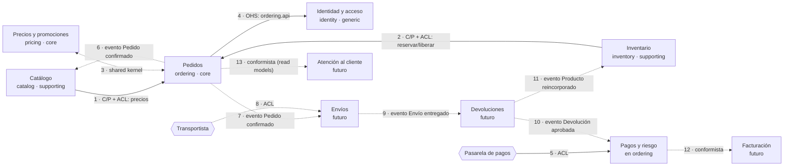

# Mapa de contextos

Sale del Event Storming del lab S19 (`docs/domain/event-storming.md`, paso 6). Lo fija el ADR
`docs/adr/0013-limites-de-los-bounded-contexts.md`, y la forma de integrarse está en
`docs/adr/0014-integracion-entre-contextos.md`. Lo vigila `ModuleBoundariesTest`: una dependencia entre
módulos que no esté en la tabla de relaciones rompe el build. Para añadirla hay dos caminos. Si es
legítima, primero se cambia este mapa (decisión humana, con ADR). Si no lo es, se corrige el código.

## Contextos

| Contexto | Módulo | Responsabilidad | Agregados | Subdominio |
|---|---|---|---|---|
| Pedidos | `ordering` | Ciclo del pedido: creación, pago, confirmación y cancelación | `Order` | **core** |
| Precios y promociones | `pricing` | Importe del pedido, cupones y descuentos por volumen | `Coupon`; `OrderPricing` como servicio de dominio | **core** |
| Catálogo | `catalog` | Alta, publicación y retirada de productos, búsqueda, ficha y disponibilidad visible | `Product` | supporting |
| Inventario | `inventory` | Saldo de stock, reservas y liberaciones | `StockBalance` | supporting |
| Identidad y acceso | `identity` | Registro, login, tokens y roles | `UserAccount`, `RefreshToken`, `PasswordResetToken` | generic |
| Pagos y riesgo | dentro de `ordering` (`PaymentGateway`, `OrderPayments`) | Intento de pago, cobro, anulación, reembolso, contracargos y retención por fraude | Intento de pago | generic (pasarela) + supporting (riesgo) |
| Envíos | sin módulo | Preparación, apartado físico, expedición, seguimiento y entrega fallida | Envío | supporting |
| Devoluciones | sin módulo | Solicitud, recepción, revisión y resultado | Devolución | supporting |
| Facturación | sin módulo | Factura y factura rectificativa | Factura | generic |
| Atención al cliente | sin módulo | Incidencias y avisos al cliente | Incidencia | supporting |

**No son contextos:** `exports` no tiene eventos en el tablero (es un detalle técnico de descarga de
ficheros). Notificaciones es un adaptador del proveedor de correo dentro del contexto que avisa.

**Shared kernel:** `pricing.domain.model` (`Money`, `OrderPricing`, `PricingOrder`, `PricingLine`),
compartido por Precios y Pedidos. Ver el ADR 0013.

## Mapa

La flecha va de upstream a downstream: el downstream depende del upstream. Las líneas continuas existen
en el código. Las discontinuas son eventos de dominio (la fila 6 existe, pero al revés: ver abajo) o
contextos futuros.

## Relaciones (aguas arriba → aguas abajo)

| # | Upstream → Downstream | Patrón | Se integra por | Desde (código) | Estado |
|---|---|---|---|---|---|
| 1 | Catálogo → Pedidos | Cliente-proveedor, Pedidos con ACL | `catalog.api.CatalogPrices` | `ordering.infrastructure.adapters.out.catalog`, `config` | ✅ |
| 2 | Inventario → Pedidos | Cliente-proveedor, Pedidos con ACL | `inventory.api.InventoryFacade` (`reserve` al crear; `release` desde `OrderCancelledListener`, ADR 0016) | `ordering.infrastructure.adapters.out.inventory`, `config` | ✅ con deuda (abajo) |
| 3 | Precios ⇄ Pedidos | Shared kernel | `pricing.domain.model` | `ordering.infrastructure.adapters.out.catalog`, `config` | ✅ |
| 4 | Pedidos → Identidad | Open host service (Pedidos publica `ordering.api` e Identidad lo implementa) | `CurrentOrderActor`, `CustomerRegistrationFacade` (`register` es un efecto síncrono, ADR 0016) | `identity.infrastructure.adapters.out.ordering`, `config` | ✅ |
| 5 | Pasarela de pagos → Pagos | ACL | `PaymentGateway` | `ordering.infrastructure.adapters.out.payment` | ✅ |
| 6 | Pedidos → Catálogo | Lenguaje publicado (evento) | `Pedido confirmado` → disponibilidad visible | hoy: `ordering` llama a `catalog.api.CatalogStockProjection` | ⚠️ al revés (deuda) |
| 6b | Inventario → Catálogo | ninguno: acceso a una tabla ajena | tabla `stock` por SQL | `catalog.infrastructure.adapters.out.mongo.CatalogStockProjectionJob` | ❌ deuda |
| 7 | Pedidos → Envíos | Cliente-proveedor por evento | `Pedido confirmado` | — | futuro |
| 8 | Transportista → Envíos | ACL | Estados del envío | — | futuro |
| 9 | Envíos → Devoluciones | Cliente-proveedor por evento | `Envío entregado` | — | futuro |
| 10 | Devoluciones → Pagos | Cliente-proveedor por evento | `Devolución aprobada en la revisión` → reembolso | — | futuro |
| 11 | Devoluciones → Inventario | Cliente-proveedor por evento | `Producto reincorporado al stock` | — | futuro |
| 12 | Pedidos, Pagos → Facturación | Conformista | `Pedido confirmado`, `Cobro anulado`, `Reembolso emitido` | — | futuro |
| 13 | Pedidos, Envíos, Devoluciones → Atención | Conformista (read models) | Estado del pedido y del envío | — | futuro |

## Dependencias prohibidas (las vigila ArchUnit)

| Regla | Test | Por qué |
|---|---|---|
| Sin ciclos entre módulos | `ModuleBoundariesTest.modules_are_free_of_cycles` | ADR 0012, 0013 |
| Un módulo solo usa el paquete publicado de otro, y solo desde `infrastructure` | `ModuleBoundariesTest.modules_only_use_the_published_api_of_other_modules` | ADR 0012, 0014 |
| Catálogo no depende de Pedidos, Inventario, Precios ni Identidad (es upstream de todos) | `ContextMapTest.catalog_depends_on_no_other_context` | ADR 0013 |
| Inventario no depende de ningún otro contexto | `ContextMapTest.inventory_depends_on_no_other_context` | ADR 0013 |
| Precios no depende de ningún otro contexto (es el dueño del shared kernel) | `ContextMapTest.pricing_depends_on_no_other_context` | ADR 0013 |
| Identidad solo depende de `ordering.api` | `ContextMapTest.identity_only_depends_on_the_ordering_open_host` | ADR 0013 |
| `exports` no depende de ningún contexto ni nadie depende de él | `ContextMapTest.exports_is_isolated` | ADR 0013 |
| Ningún módulo accede a entidades JPA, repositorios ni documentos Mongo de otro | `ContextMapTest.no_module_touches_another_modules_persistence` | ADR 0014 §3 |
| Ningún módulo nombra en SQL una tabla de otro (excepción congelada: `stock` desde catalog) | `TableOwnershipTest` (lee el código fuente: ArchUnit no ve strings SQL) | ADR 0014 §3 |

## Paquete publicado de cada módulo

| Módulo | Publica | Qué es |
|---|---|---|
| `catalog` | `catalog.api` | `CatalogPrices` (precios para un pedido) y `CatalogStockProjection` (proyección del stock tras confirmar) |
| `inventory` | `inventory.api` | `InventoryFacade` (reservar y liberar stock) |
| `ordering` | `ordering.api` | `CustomerRegistrationFacade` (alta del cliente) y `CurrentOrderActor` (lo implementa identity) |
| `pricing` | `pricing.domain.model` | Shared kernel sin fachada: `OrderPricing`, `PricingOrder`, `PricingLine`, `Money` |
| `identity` | nada | Nadie depende de identity |
| `exports` | nada | Módulo aislado |

## Deuda conocida

- **`inventory.api` publica tipos de su dominio** (lab S12, congelada en `src/test/resources/archunit_store/`).
  `InventoryFacade` recibe `StockLine` y devuelve `ReservationResult`, ambos de `inventory.domain.model`,
  así que los adaptadores de ordering dependen del dominio de inventory. Corrección: tipos propios en
  `inventory.api` y traducción dentro de inventory.
- **Fila 6 al revés** (lab S19). Pedidos decide cuándo se actualiza la disponibilidad del catálogo
  llamando a `CatalogStockProjection` desde su relay. Según el ADR 0014, Catálogo debería suscribirse al
  evento `Pedido confirmado`. Se corrige en la Sección 39 (eventos entre servicios). Hasta entonces es la
  única llamada de Pedidos a Catálogo que no es una consulta.
- **Catálogo lee la tabla `stock` de Inventario** (lab S19). `CatalogStockProjectionJob` hace
  `select product_id, available from stock` por JDBC: es una dependencia de datos Inventario → Catálogo que
  no aparece en los imports y que ArchUnit no ve. La vigila `TableOwnershipTest` como única excepción
  permitida. Se corrige cuando Catálogo consuma eventos de Inventario (ADR 0014, Sección 39).
- **Pagos y riesgo vive dentro de `ordering`**, y `Order.refund` mezcla *Cobro anulado* y *Reembolso*
  (prueba del cambio del lab S19). Se separa al partir en servicios (Sección 35).
- **Liberación de stock y alta de cliente síncronas** (lab S20, ADR 0016). `ordering` llama a
  `InventoryFacade.release` e `identity` a `CustomerRegistrationFacade.register`: son órdenes a otro
  contexto, no reacciones a un evento. Pasan a evento en la Sección 39.

## Prueba del cambio (lab S19)

| Funcionalidad | Contextos que tocó | Lectura |
|---|---|---|
| Buscador (S09) | 1: Catálogo | Frontera bien puesta |
| Caché del catálogo (S11) | 1: Catálogo | La invalidación (`ProductChanged`) es interna |
| Refresh tokens (S12) | 1: Identidad | Frontera bien puesta |
| Cupones | 1: Precios | Cuadra, pero el cupón no llega al checkout. Al conectarlo tocará Precios y Pedidos (shared kernel) |
| Reembolso (S12) | 2: Pedidos + Identidad (rol) | Para negocio toca Devoluciones, Pagos y Facturación. Pedidos absorbió conceptos ajenos |

## Comprobación contra el código (lab S18, paso 5)

Las dependencias reales entre módulos (imports de `src/main`) coinciden con la tabla: identity →
ordering.api (5 imports), ordering → catalog.api (5), ordering → inventory.api (3), ordering →
pricing.domain.model (4) y ordering → inventory.domain.model (2: la deuda de arriba).
